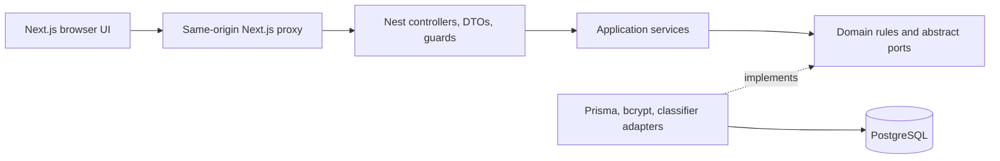
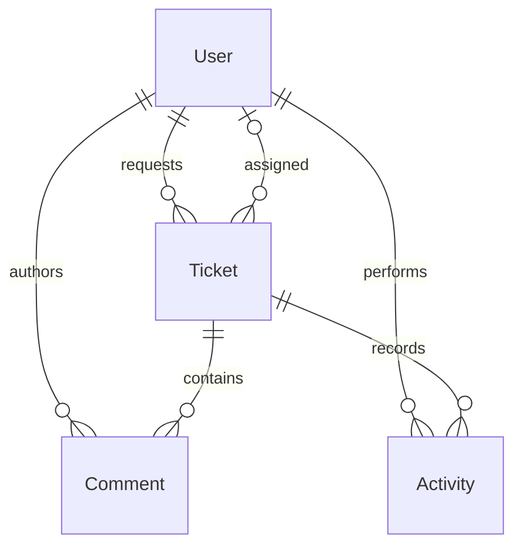
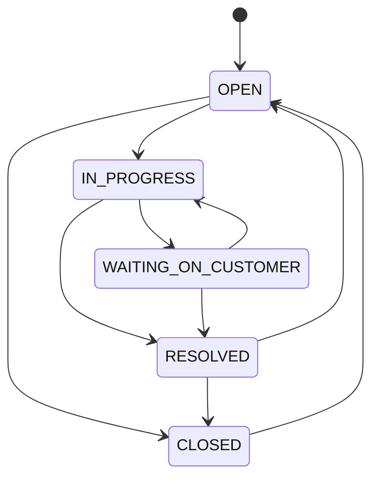

# Architecture and decisions

## Dependency direction

`auth`, `users`, `tickets`, and `ai` are feature modules. Controllers handle transport; services orchestrate use cases; domain code owns policies and repository contracts; adapters implement infrastructure. Module declarations bind implementations through dependency injection.

Domain code has no framework imports. Application services pragmatically use Nest DI and transport exceptions; a larger system could map application errors at the presentation boundary. This is a modular monolith designed to remain explainable and replaceable without microservice complexity.

## Relationships

Users have unique normalized emails, bcrypt hashes, and roles. Tickets have UUIDs, sequential display numbers, status/priority/category enums, required requesters, optional assignees, JSON analysis, timestamps, and versions. Comments and activities reference both tickets and authors/actors. Indexes support queue filters, requester timelines, assignment, and child-record lookup. Deletion cascades replies and activities; activity is not a tamper-proof compliance log.

## Lifecycle

Staff can use the full graph. Customers can only reopen or close their own resolved tickets. Reopening clears `resolvedAt`; resolution/closure sets it if unset. Closed tickets reject comments.

Customer access scopes detail, list, statistics, edits, and comments to ownership. A foreign customer's ticket returns 404. Customers edit content only while open; staff control triage and assignment. Agents claim unassigned tickets for themselves, while admins reassign/unassign and delete. All replies are shared; there are no private notes.

## Transactions and conflicts

Updates, analysis, and deletion require the current `version`. Writes atomically match `(id, version)` and increment it. Activity is inserted in the same transaction. Concurrent losing writes return 409. Comment creation also increments the version transactionally, guarding against a simultaneous close or delete. List/count and statistics use repeatable-read snapshots. Search matches content case-insensitively or an exact numeric ticket number; pagination is bounded to 50 rows.

## Security boundary

Registration rejects unknown properties and always creates customers. Passwords use bcrypt cost 12; safe projections remove hashes. JWTs constrain issuer, audience, algorithm, subject, and expiry. Guards load current users/roles from PostgreSQL rather than trusting role claims in tokens.

The browser uses a same-origin Next.js proxy with an HttpOnly cookie. The proxy forwards supported paths, checks write origins, and strips bearer tokens from login/registration JSON. Nest separately checks cookie write origins, applies CORS, Helmet, validation, and throttling. Direct API clients and Swagger use bearer tokens. Logout clears cookies but does not revoke copied tokens. Production Secure cookies require HTTPS.

## AI boundary

The `TicketAnalyzer` port has a local Naive Bayes adapter. The model never executes ticket content or sends it outside the process. Staff analysis is explicit, version-checked, and audited; reviewed fields are applied through the normal update use case. Content edits mark previous analysis stale. A future external provider would need structured-output validation, timeouts, privacy controls, failure handling, and representative evaluation.

## API inventory

All routes below use `/api/v1`.

| Method | Path                          | Access                                   |
| ------ | ----------------------------- | ---------------------------------------- |
| POST   | `/auth/register`              | Public; customer only                    |
| POST   | `/auth/login`, `/auth/logout` | Public; session cookie                   |
| GET    | `/auth/me`                    | Authenticated                            |
| GET    | `/auth/staff`                 | Staff                                    |
| GET    | `/tickets`, `/tickets/stats`  | Scoped                                   |
| POST   | `/tickets`                    | Authenticated                            |
| GET    | `/tickets/:id`                | Owner/staff                              |
| PATCH  | `/tickets/:id`                | Field/transition rules; version required |
| DELETE | `/tickets/:id`                | Admin; version required                  |
| POST   | `/tickets/:id/comments`       | Owner/staff; not closed                  |
| POST   | `/ai/preview`                 | Authenticated; no persistence            |
| POST   | `/tickets/:id/analysis`       | Staff; version required                  |
| GET    | `/health`                     | Public database readiness                |

Swagger describes request validation and security at `/docs`. Errors expose status/message rather than database internals or credentials. UUID parameters are validated before persistence access.
