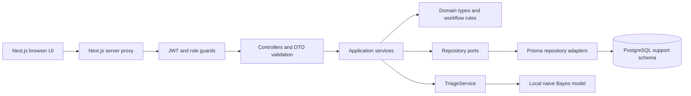

# Architecture

The API is a NestJS modular monolith backed by PostgreSQL through Prisma 7. Its independent
`backend/` project exposes REST endpoints under `/api/v1` and interactive OpenAPI
documentation at `/docs`. The frontend boundary is a separate Next.js App Router
project, with browser requests passing through a server proxy that forwards the
HTTP-only session cookie. The API remains the authority for validation, access
control, ticket state, and persistence.

## Module boundaries

Each business module owns its HTTP adapter, use cases, domain contracts, and
persistence adapters. Nest modules compose concrete dependencies through providers.

| Layer          | Responsibilities                                                                                             | Examples                                                                                   |
| -------------- | ------------------------------------------------------------------------------------------------------------ | ------------------------------------------------------------------------------------------ |
| Presentation   | REST controllers, request validation, OpenAPI metadata, authentication and role guards                       | `auth/presentation`, `tickets/presentation`, `users/presentation`                          |
| Application    | Coordinate use cases, enforce user access, call domain rules and repository ports                            | `AuthService`, `TicketsService`, `UsersService`, `TriageService`                           |
| Domain         | Framework-independent types, workflow rules, repository and password hashing contracts, local classification | `TicketRepository`, `UserRepository`, `PasswordHasher`, `workflow.ts`, `TicketTriageModel` |
| Infrastructure | Implement PostgreSQL repositories with Prisma, bcrypt hashing, curated model training data                   | `PrismaTicketRepository`, `PrismaUserRepository`, `BcryptPasswordHasher`                   |

Application input interfaces are independent of controller DTOs. Controllers
validate HTTP input and pass structurally compatible values to the application
services. Domain repository ports are abstract classes, allowing Nest dependency
injection without coupling use cases to Prisma models. A shared global Prisma
module owns the generated client and PostgreSQL driver adapter. Infrastructure maps
database records to explicit public domain records rather than returning database rows.
Application services use Nest exceptions for HTTP-oriented use case failures;
domain workflow and classification code remain usable without Nest.

## Data ownership and existing database preservation

The application uses the existing database selected by `DATABASE_URL`. Its
business tables live in the dedicated `support` schema:

- `users`: normalized unique email, display name, bcrypt hash, role, timestamps.
- `tickets`: generated display number, requester, optional assignee, status,
  category, priority, version, triage JSON, timestamps, and soft deletion marker.
- `comments`: public replies and staff-only internal notes.
- `ticket_events`: actor, action, description, and timestamp for audit history.

Prisma's schema and checked-in SQL migrations live in `backend/prisma`. Prisma
configuration and the shared runtime client select `support` as the connection
schema, so Prisma records migrations in `support._prisma_migrations`. Existing
tables and `_prisma_migrations` in `public` belong to the earlier application and
remain untouched. Starting the API connects to the database without applying
migrations, creating tables, or installing extensions.

`npm run db:migrate` invokes `backend/scripts/migrate.cjs`. For an empty support
schema, it deploys the SQL baseline using `prisma migrate deploy`. For the existing
TypeORM installation, it verifies the legacy migration record and support schema
before marking the equivalent Prisma baseline as applied, then deploys pending
migrations. Adoption records migration history without recreating tables or
rewriting existing data. The old `support_migrations` bookkeeping remains in
place. An incomplete or incompatible schema must be reviewed before adoption;
the wrapper stops when validation fails.

The baseline retains the original database UUID defaults, identity ticket
numbers, timestamp types, CHECK constraints, foreign keys, and partial indexes.
Role, status, category, and priority remain checked `varchar` columns. These
database constraints are preserved in migration SQL even where the Prisma schema
cannot express them. The migration relies on PostgreSQL's available
`gen_random_uuid()` function.

For future schema changes, create a migration against a separate disposable
development database using `prisma migrate dev`, review its SQL for preserved
constraints and indexes, and commit the migration. Deploy reviewed migrations
through `db:migrate`. Existing application databases use explicit migrations;
`db push` and database reset commands are not part of this workflow.

Database constraints enforce valid roles, statuses, categories, priorities,
positive versions, nonempty data, foreign keys, and an assignee for active or
resolved work. Indexes cover recent tickets, requester and assignee queues, status,
and per-ticket conversations. Prisma queries and parameterized SQL handle search,
filters, and aggregates. Search escapes SQL wildcard characters; custom priority
ordering and ticket-number substring search retain their PostgreSQL behavior.

## Authentication and role visibility

Registration always creates a `CUSTOMER`; a client cannot request staff
privileges. Passwords use bcrypt with cost 12. Input limits account for bcrypt's
72 UTF-8 byte limit. Login verifies a valid dummy hash for unknown emails to avoid
skipping the password verification work. Duplicate registrations are also caught
by the database's unique constraint if two requests race.

Successful registration and login set `support_session`, a two-hour JWT session
cookie. It is HTTP-only, uses `SameSite=Lax`, and is secure in production. The API
also accepts a Bearer token for API clients. JWT verification pins HS256, checks
expiry and the subject format, and reloads the current user from the database;
roles are not trusted from an old token payload. Responses map to public user
fields and never include a password hash. Logout clears the browser cookie;
tokens are stateless and are not individually revoked before expiry.

Unsafe browser requests with an `Origin` header must match the configured
`FRONTEND_URL` or `API_ORIGIN`; the API origin supports Swagger's own requests.
Credentialed CORS permits the configured frontend origin. HTTPS origins and secure
cookies are required in production. Helmet, strict DTO validation, global rate
limits, tighter authentication limits, and sanitized server error responses are
configured centrally.

| Action                                           | Customer         | Agent              | Administrator      |
| ------------------------------------------------ | ---------------- | ------------------ | ------------------ |
| List, search, dashboard counts                   | Own tickets      | All tickets        | All tickets        |
| Read a ticket and public replies                 | Own tickets      | All tickets        | All tickets        |
| Read or write internal notes                     | No               | Yes                | Yes                |
| Create tickets and public replies                | Yes              | Yes                | Yes                |
| Edit title and description                       | Own open tickets | Any visible ticket | Any visible ticket |
| Assign, reprioritize, recategorize, rerun triage | No               | Yes                | Yes                |
| Delete a ticket                                  | Own open tickets | No                 | Any ticket         |

Tickets belonging to another customer return 404, limiting information about
their existence. Customer list filters and aggregate queries receive a
server-assigned requester scope. Internal comments are excluded at query time;
their corresponding audit events are excluded from customer detail responses.
Assignees must be agents or administrators.

## Workflow

```mermaid
stateDiagram-v2
  [*] --> OPEN: Ticket created
  OPEN --> IN_PROGRESS: Staff; assignee required
  IN_PROGRESS --> RESOLVED: Staff; assignee required
  IN_PROGRESS --> OPEN: Staff reopens work
  OPEN --> CLOSED: Requester or staff
  IN_PROGRESS --> CLOSED: Requester or staff
  RESOLVED --> CLOSED: Requester or staff
  RESOLVED --> OPEN: Requester or staff reopens
  CLOSED --> OPEN: Requester or staff reopens
```

Unchanged states and skipped transitions are rejected. The detail response
includes role-appropriate possible next statuses; starting or resolving work also
requires an assignee. An active or resolved ticket cannot have its assignee
removed until it is reopened. Entering `RESOLVED` records `resolvedAt`; reopening
clears it. Closed tickets accept no new comments until reopened. Deletion is soft
archival, retaining the conversation and event history.

## Transactions and concurrency

Ticket edits, status changes, deletion, and staff triage requests carry the
current `version`. The service checks that version, and the repository makes an
atomic update using both ticket ID and expected version in the SQL predicate.
The same Prisma transaction increments the version and inserts its audit event. If
another request has already saved or archived the ticket, zero rows match and the
API returns 409. The client should fetch the current ticket, preserve its draft,
and let the user reapply the intended change. A pre-read version check alone is
not relied on for concurrency safety.

Ticket creation and its first event are transactional. Adding a comment locks
the ticket row, rechecks that it is open to replies and not archived, then writes
the comment, timestamp, and event in one transaction. This serializes against
concurrent status changes or deletion and prevents a late reply from being added
to a closed or removed ticket. Comments do not increment the ticket edit version.

## Verification boundaries

Domain and application tests exercise workflow, authentication, input validation,
access guards, and local triage. Database-backed HTTP tests should validate the
full authentication and ticket workflow, cross-customer isolation, internal note
visibility, stale version rejection, and closed-ticket comment behavior against
the migrated PostgreSQL schema. The API health endpoint executes `SELECT 1` so a
successful check includes database connectivity.

See [the AI evaluation notes](./ai-evaluation.md) for model behavior and limits.
